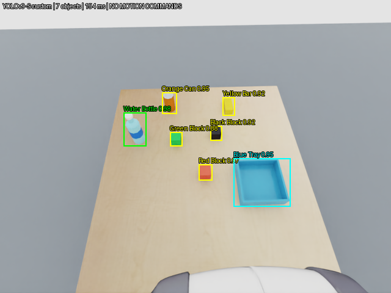
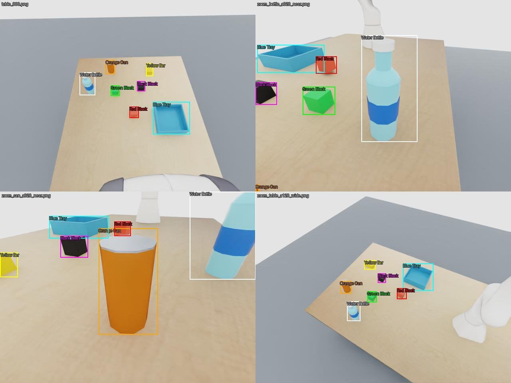
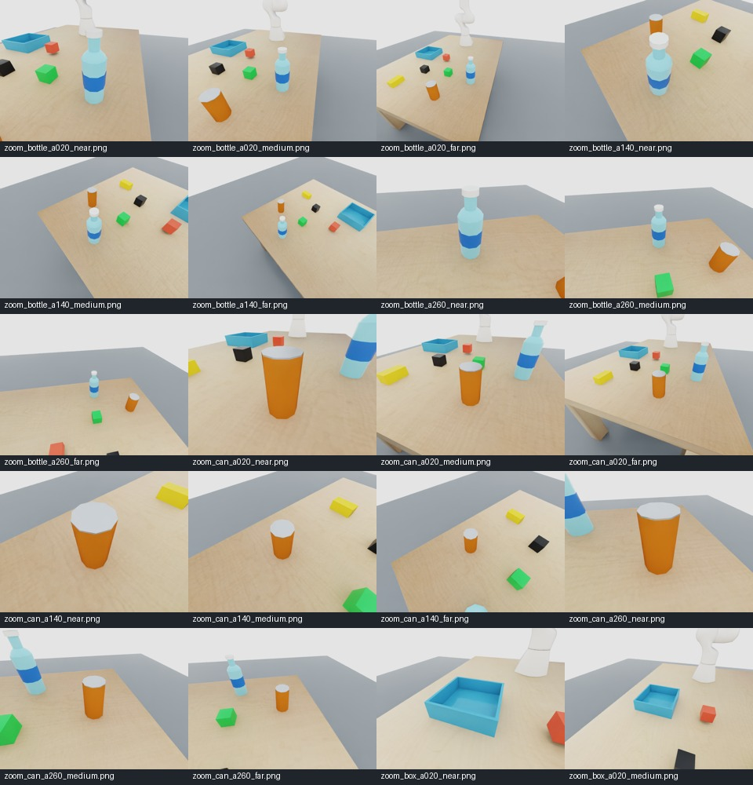
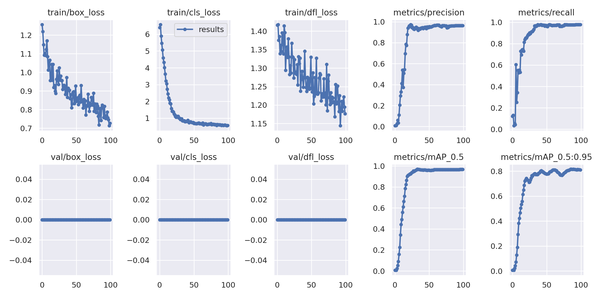
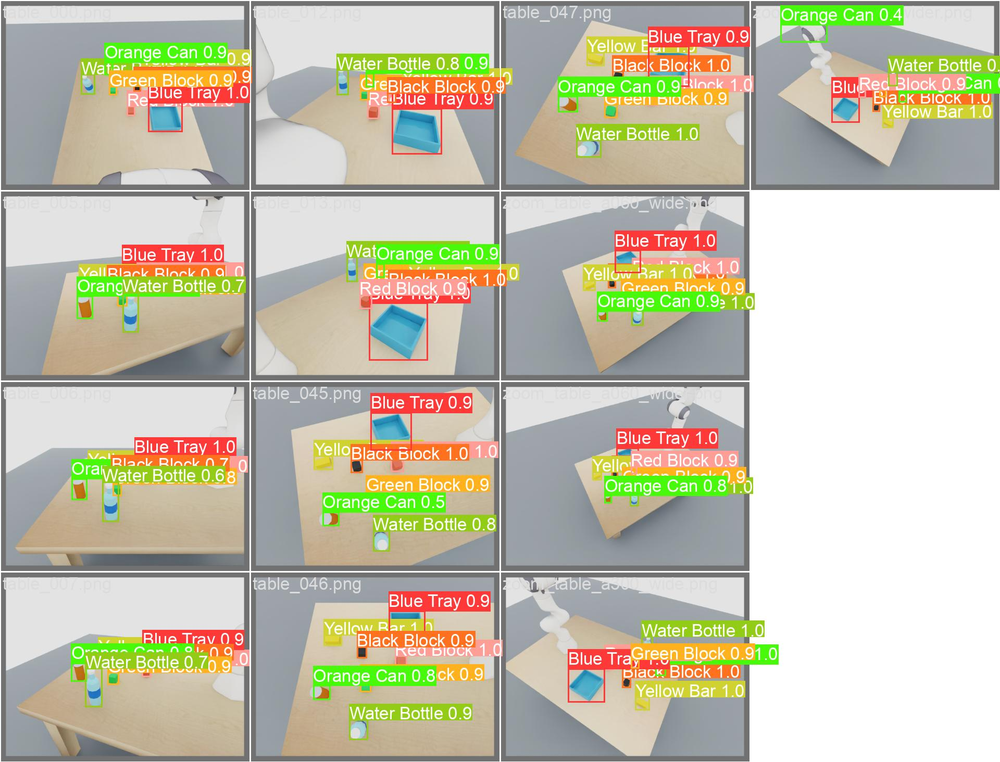
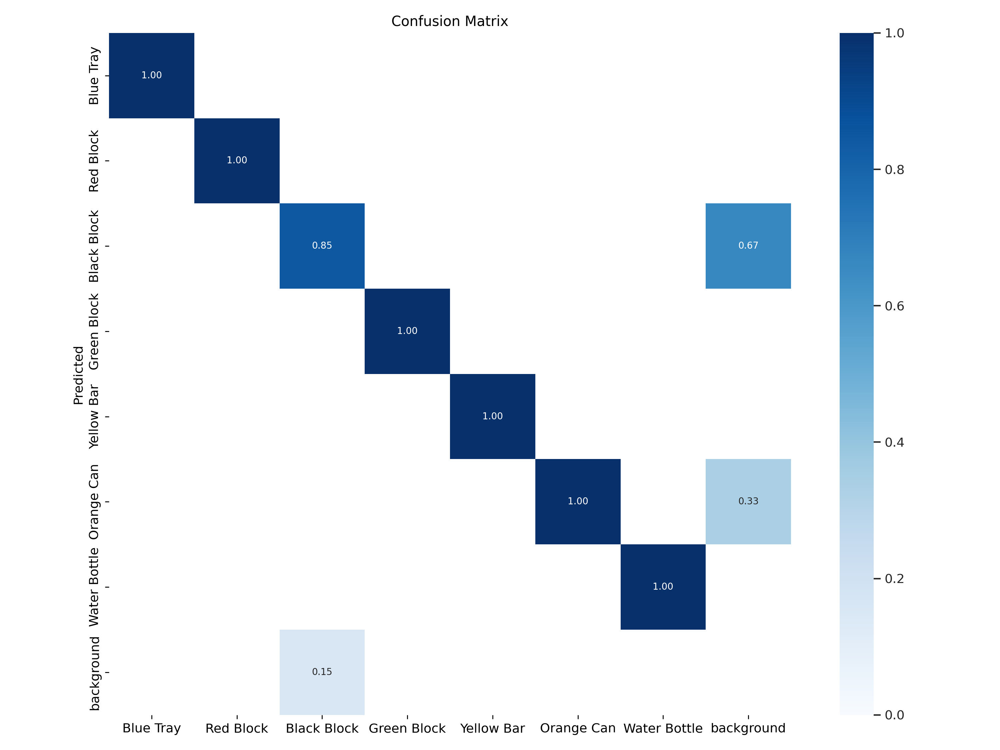
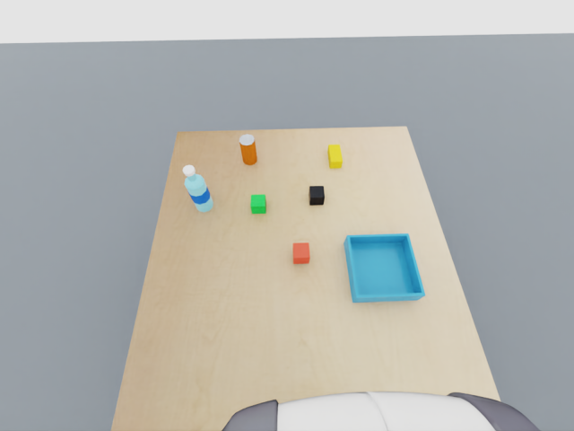
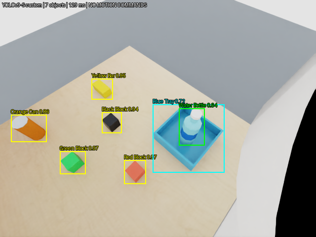

<div align="center">

# ROBOT_VLA
### From synthetic images to camera-guided robot manipulation

**Franka Panda · NVIDIA Isaac Sim · ROS 2 Jazzy · CVAT · Official YOLOv9-S**

[](https://developer.nvidia.com/isaac/sim)
[](https://docs.ros.org/en/jazzy/)
[](https://github.com/WongKinYiu/yolov9)
[](#status--verified-results)

An end-to-end robotics learning project: build a multi-object world, capture virtual-camera images, label them in CVAT, train a detector, and connect perception to guarded manipulation.



*Actual saved ROS wrist-camera output from the fine-tuned model—not a concept render.*

[Workflow](#the-complete-workflow) · [Dataset](#dataset--cvat-labeling) · [Training results](#training--evaluation) · [Virtual camera](#virtual-wrist-camera) · [Getting started](#getting-started) · [Documentation](#documentation)

</div>

> **Project maturity:** this repository implements perception, geometric planning, and simulation controllers. A learned **Vision-Language-Action policy is a future goal**, not an implemented feature. The text-command interface is an explicit allowlist, not an LLM or speech system. No physical robot has been validated.

## Status & verified results

| Component | Evidence and scope |
|---|---|
| Multi-object tabletop | Panda arm, receiving tray, three colored blocks, yellow bar, orange can, and water bottle in Isaac Sim |
| CVAT annotations | 73 source images, 423 bounding boxes, seven custom classes |
| Official YOLOv9-S training | 100 epochs completed; final best-checkpoint revalidation: **96.6% mAP@50**, **81.8% mAP@50:95** |
| Frozen wrist RGB-D preview | Synchronized RGB, depth, camera calibration, TF, and live detection overlays over ROS 2 |
| Moving wrist video | RGB and YOLO overlays from the actual moving simulation; separate from the RGB-D preview |
| Red cube → blue box | Complete validated pick, lift, transfer, release, and retreat; visible run repeated successfully on 2026-11-10 |
| Bottle → blue tray | One successful **visible guarded validation** on 2026-10-21, including release, retreat, and HOME return |
| Green cube beside bottle | **Blocked** by gripper/bottle clearance; not a successful placement |
| General VLA / real hardware | Not implemented / not validated |

Scores are from a small **single-scene synthetic validation set**, not an independent test set. Successful simulation runs are not general reliability or hardware-safety claims.

## The complete workflow

```mermaid
flowchart LR
    A[Isaac Sim tabletop] --> B[Virtual camera captures]
    B --> C[Manual CVAT bounding boxes]
    C --> D[COCO export and dataset audit]
    D --> E[Grouped split and YOLO conversion]
    E --> F[Official YOLOv9-S training]
    F --> G[ROS wrist-camera detections]
    G --> H[RGB-D target estimation]
    H --> I[IK and guarded validation]
    I --> J[Simulation pick and place]
```



1. **Build the scene.** Import the Panda and table; add separately modeled objects with collision and rigid-body properties.
2. **Capture views.** Record an initial wrist view plus virtual orbit and close-up views. Orbit cameras are synthetic viewpoints, not verified robot trajectories.
3. **Label in CVAT.** Draw bounding boxes using consistent class names; export the annotations as COCO detection JSON.
4. **Audit and convert.** Validate images and boxes, exclude known bad views, keep related camera angles together, and generate a new YOLO dataset without modifying the source export.
5. **Fine-tune YOLOv9-S.** Use the official dual-head training code in an isolated GPU environment.
6. **Run live perception.** Feed ROS RGB frames to the custom model; view raw and annotated images separately in RViz.
7. **Estimate targets.** Combine accepted bottle/tray detections with registered depth, calibration, TF, and known scene geometry.
8. **Validate manipulation.** Check IK, joint tracking, physical grip evidence, slip, contacts, and supported placement. Execution needs a matching successful validation; failure does not trigger an automatic retry.

**Full walkthrough:** [Image capture → CVAT → training → live camera](docs/dataset_to_robot.md).

## Dataset & CVAT labeling



*Preview rendered from the exported manual annotations. This is not a screenshot of the CVAT interface and not model-generated ground truth.*

| YOLO ID | Class | Scene object |
|---:|---|---|
| 0 | Blue Tray | Open receiving box |
| 1 | Red Block | Red cube |
| 2 | Black Block | Black cube |
| 3 | Green Block | Green cube |
| 4 | Yellow Bar | Elongated yellow block |
| 5 | Orange Can | Orange cylindrical container |
| 6 | Water Bottle | Cyan/blue bottle |

The source CVAT export contains **73 images / 423 boxes**. Two occluded views are excluded from the derived training dataset:

| Split | Images | Boxes |
|---|---:|---:|
| Training | 58 | 331 |
| Validation | 13 | 91 |
| Total used | **71** | **422** |

The split groups views by **60° camera azimuth sector** to reduce leakage between related close-ups and wide views. All seven classes occur in both splits. There is no independent test set.

<details>
<summary><strong>View the synthetic camera-angle gallery</strong></summary>



Capture overview only; the full capture collection is larger than the selected labeled dataset. Quality exclusions are recorded separately.

</details>

## Training & evaluation

Uses [WongKinYiu/yolov9](https://github.com/WongKinYiu/yolov9), pinned to revision `5b1ea9a8b3f0ffe4fe0e203ec6232d788bb3fcff`. **No Ultralytics package.**

- **Architecture:** YOLOv9-S, original dual-head pretrained weights and `train_dual.py`.
- **Run:** 100 epochs, batch size 8, 640-pixel input, AdamW, cosine learning rate, seed 42.
- **Augmentation:** color-aware settings; hue changes and mixup disabled.
- **Isolation:** GPU training, CPU inference, and Isaac Sim use separate Python environments.
- **Provenance:** source revision, weight hashes, dataset audit, and run metadata are checked or recorded.

| Final best-checkpoint revalidation | All classes | Water Bottle |
|---|---:|---:|
| Precision | 0.962 | 0.996 |
| Recall | 0.976 | 1.000 |
| AP@50 (mean for all classes) | **0.966** | **0.995** |
| AP@50:95 (mean for all classes) | **0.818** | **0.767** |



*The upstream training code records zero validation losses because that loss calculation is disabled; these zeros do not mean perfect predictions. Final fused-checkpoint metrics differ slightly from the selected CSV epoch (85, zero-based).*

<details>
<summary><strong>Validation predictions and confusion matrix</strong></summary>





Black Block is the weakest class (AP@50 **0.790**). The validation montage includes a false Orange Can detection on the robot. New layouts, lighting, and independent scenes are needed before making generalization claims.

</details>

See [training configuration, checkpoint hash, and reproduction steps](docs/yolov9_training.md).

## Virtual wrist camera

The camera is parented to the Panda hand in a **session layer**, so the saved scene is not overwritten. It is an ideal virtual pinhole sensor, not a simulated physical camera housing or a calibrated real camera.

| Frozen preview (ROS domain 44) | Moving validation (ROS domain 46) |
|---|---|
| 640 × 480 RGB + registered optical-axis depth | RGB diagnostic video from the moving robot |
| Matching RGB/depth CameraInfo and TF | No moving depth, CameraInfo, or TF published |
| Physics frozen; preview playback locked | Guarded physics controlled by the validation launcher |
| Supplies a fresh pre-motion target snapshot | Displays live detections; **not visual servoing** |



| Topic | Purpose |
|---|---|
| `/wrist_camera/color/image_raw` | Original RGB image (`rgb8`) |
| `/wrist_camera/depth/image_raw` | Registered optical-axis depth in metres (`32FC1`), domain 44 |
| `/wrist_camera/color/camera_info` | RGB calibration, domain 44 |
| `/wrist_camera/depth/camera_info` | Depth calibration, domain 44 |
| `/tf` | `world → panda_hand → wrist_camera_optical_frame`, domain 44 |
| `/wrist_camera/detections/image` | RGB with boxes, labels, and confidence scores |
| `/wrist_camera/detections/objects` | Detection metadata as JSON in a ROS string message |

The baseline calibration is `fx = fy = 320`, `cx = 320`, `cy = 240`. The preview publishes the current camera transform/intrinsics with synchronized wall-clock stamps, at up to approximately 5 Hz. Use `use_sim_time=false` in RViz. Never combine domain-46 RGB with domain-44 depth.

**Guides:** [Camera and RViz](docs/wrist_camera.md) · [Trained detection and geometry](docs/trained_wrist_detection.md).

## Camera-guided manipulation



*Saved domain-46 camera output with the bottle in the tray. “NO MOTION COMMANDS” describes the detector node: a separate guarded controller owns movement. The image alone does not establish a successful grasp; the validation report records the outcome.*

The completed bottle validation recorded **floor support, open fingers, gripper retreat, and HOME return**, with peak carry slip **3.089 mm**. It published **2,443 RGB frames**. Control used a pre-motion RGB-D snapshot and model-specific geometry, not continuous image-based servoing.

The green-cube-beside-bottle experiment remains blocked by clearance. Its failed validation is documented rather than presented as a success. No increase in force or bypass of contact guards is proposed as a shortcut.

- [Validated red-cube pick and place](docs/panda_pick_place.md)
- [Bottle validation evidence and limitations](docs/trained_wrist_detection.md)
- [Green-cube clearance investigation](docs/green_cube_validation.md)
- [Allowlisted text-command interface](docs/robot_tabletop_command.md)

## Getting started

### 1. Clone the source

```bash
git clone https://github.com/Abbas123-code/ROBOT_VLA.git
cd ROBOT_VLA
```

Git includes source, configuration, guides, and the curated gallery above. **Full datasets, CVAT exports, trained weights, USD scenes/assets, environments, and runtime logs are not included.** The gallery is documentation, not a complete training dataset. Restore your own assets/export or use a separately supplied transfer bundle; no public dataset/weight download is promised here.

### 2. Choose a workflow

| Goal | Start here | Requirements |
|---|---|---|
| Explore code and results | This README and [workflow guide](docs/dataset_to_robot.md) | No simulator needed |
| Offline pretrained YOLO inference | [Portable setup](docs/portable_setup.md) | Linux x86_64, Docker + Compose, Make; internet for first build |
| Reproduce custom training | [YOLOv9-S training](docs/yolov9_training.md) | Restored CVAT export, isolated training environment, compatible NVIDIA GPU |
| View live wrist detections | Steps below | Prepared Isaac/ROS host, local scene assets, pinned custom checkpoint |
| Run guarded manipulation | [Pick/place guide](docs/panda_pick_place.md) | Fresh matching validation on the target machine |

The CPU container uses the **pretrained official COCO model**, not the seven-class custom checkpoint. It does not run Isaac Sim or CVAT, expose ROS control, or train a policy. See the portable guide for `make build`, `make doctor`, `make inspect`, and `make detect`.

### 3. Live camera on a prepared host

Tested stack: **Ubuntu 24.04 · Python 3.12 · ROS 2 Jazzy · Isaac Sim 6.2.0.0**. Install according to the official platform requirements; do not copy virtual environments between machines. Restore local scene assets and the custom checkpoint first. These are launch commands, not a fresh-machine installer.

**Terminal A — frozen RGB-D camera:**

```bash
source /opt/ros/jazzy/setup.bash
./env_isaacsim/bin/python isaac/scripts/wrist_camera_ros.py
```

**Terminal B — trained seven-class CPU detector (no motion):**

```bash
source /opt/ros/jazzy/setup.bash
./env_yolov9_cpu/bin/python scripts/wrist_yolo_ros.py
```

**Terminal C — RViz:**

```bash
source /opt/ros/jazzy/setup.bash
ROS_DOMAIN_ID=44 RMW_IMPLEMENTATION=rmw_fastrtps_cpp rviz2 -d configs/wrist_camera.rviz
```

Enable **Wrist RGB**, **Wrist depth**, and **Wrist YOLO boxes** in the Displays panel if needed. Let the camera preview remain frozen; no robot movement is part of this quick start. Close each application or use Ctrl+C in its terminal when finished.

## Architecture & repository map

**Body = Isaac Sim · Nerves = ROS 2 · Brain = perception and control code**

| Area | Contents |
|---|---|
| [isaac/README.md](isaac/README.md) | Scene builders, camera publishers, simulation controllers |
| [ros2_ws/README.md](ros2_ws/README.md) | ROS package, telemetry, kinematics, simulation command interfaces |
| [src/README.md](src/README.md) | Perception, geometry, control, and learning foundations |
| [configs/yolov9_tabletop.json](configs/yolov9_tabletop.json) | Custom checkpoint contract and exact class mapping |
| [scripts/prepare_yolov9_dataset.py](scripts/prepare_yolov9_dataset.py) | CVAT COCO audit and YOLO conversion |
| [scripts/train_official_yolov9.py](scripts/train_official_yolov9.py) | Reproducible official training launcher |
| [scripts/wrist_yolo_ros.py](scripts/wrist_yolo_ros.py) | Live ROS detector and synchronized target capture |
| [tests/test_tabletop_perception.py](tests/test_tabletop_perception.py) | Perception and message-contract regression tests |
| [docs/images/README.md](docs/images/README.md) | Gallery sources and publication provenance |

## Documentation

| Topic | Guide |
|---|---|
| Complete data-to-robot process | [Dataset and camera workflow](docs/dataset_to_robot.md) |
| Foundations | [The basics](docs/00_the_basics.md) · [Transforms](docs/phase1_transforms.md) |
| Scene design | [Cluttered tabletop](docs/cluttered_tabletop.md) |
| Annotation and training | [Fine-tuning YOLOv9-S](docs/yolov9_training.md) |
| Camera and perception | [Wrist RGB-D](docs/wrist_camera.md) · [Trained detections](docs/trained_wrist_detection.md) |
| Manipulation | [Panda pick/place](docs/panda_pick_place.md) · [Text commands](docs/robot_tabletop_command.md) |
| Portability | [Docker and transfer bundles](docs/portable_setup.md) |

## Tests

The non-simulation regression suite covers dataset conversion, perception input
contracts, command approval, contact evidence, geometry, and controller guards.
On 2026-11-11, **102 tests ran: 101 passed, one optional recorded-model test
skipped**. This does not launch Isaac Sim or replace physical simulation validation.

On the prepared ROS/CPU-inference environment:

```bash
source /opt/ros/jazzy/setup.bash
./env_yolov9_cpu/bin/python -m unittest discover -s tests -p 'test_*.py' -v
```

## Limitations & next steps

- Expand object layouts, illumination, backgrounds, and independent validation/test scenes.
- Resolve full-gripper clearance before retrying the green-cube placement.
- Add and validate moving RGB-D calibration before considering closed-loop visual servoing.
- Collect demonstration trajectories and implement a learned VLA policy as a separate milestone.
- Keep simulation validation separate from any future hardware commissioning.

## Attribution & licensing

Built with [NVIDIA Isaac Sim](https://developer.nvidia.com/isaac/sim), [ROS 2](https://www.ros.org/), [CVAT](https://github.com/cvat-ai/cvat), [PyTorch](https://pytorch.org/), and [official YOLOv9](https://github.com/WongKinYiu/yolov9). Panda/table source assets are documented in [the asset manifest](configs/simulation_assets.json).

YOLOv9 upstream is GPL-3.0; NVIDIA software and downloaded assets have their own terms. This repository does not currently declare a top-level license for its original code. Public availability is not a blanket license grant; check applicable permissions before redistribution.