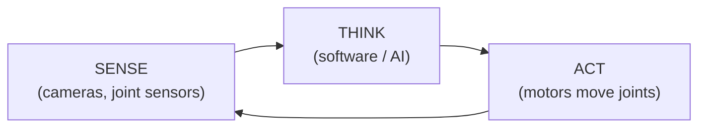
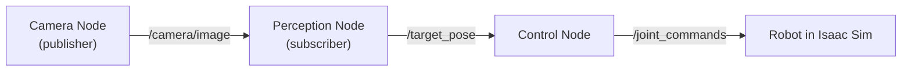
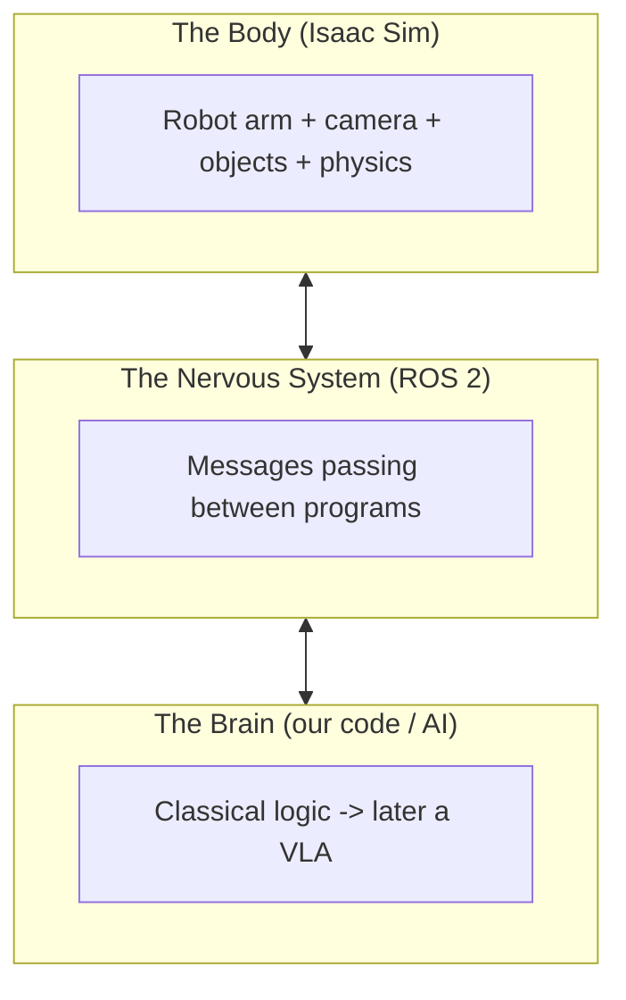

# The Absolute Basics (Read This First)

> No setup, no commands. Just plain-language foundations so nothing later feels like magic.
> Mental model of the whole project: **Body (Isaac Sim), Nerves (ROS 2), Brain (our code -> VLA).**

---

## 1. What is a robot (in our context)?

A robot is a machine that **senses, thinks, and acts**:



Our robot is a **robot arm** (a manipulator), like a human arm bolted to a table:
- **Links** = rigid segments (upper arm, forearm).
- **Joints** = movable connections (shoulder, elbow, wrist).
- **End-effector** = the "hand" / gripper at the tip.

Robot "moving" = **motors rotate the joints**, repositioning the hand in space.

---

## 2. What does "control a robot" actually mean?

At the lowest level, controlling a robot = **choosing the angle of each joint**.

A 6-joint arm has 6 angles, e.g.:
```
[ 0deg, -45deg, 90deg, 0deg, 45deg, 0deg ]
```
Change those numbers -> the arm moves. **Every robot motion is ultimately a change in these numbers.**

---

## 3. Why simulation? What is Isaac Sim?

Real robot arms are expensive, slow, and breakable. So we practice in a **simulator** — a physics-accurate virtual world.

**NVIDIA Isaac Sim** gives us:
- A virtual robot arm.
- Virtual cameras producing real-looking images.
- Virtual objects (red cube, box).
- Real physics (gravity, collisions, friction).

What we learn in sim mostly transfers to real robots later — **Phase 17, "sim-to-real."**

---

## 4. What is ROS 2?

The robot's software is **many small programs that must talk to each other**:
- one reads the camera,
- one detects objects,
- one decides the action,
- one drives the motors.

**ROS 2 (Robot Operating System 2)** is the "postal service" connecting them. Not an OS like Windows — a **communication + tooling framework** for robots.

Core vocabulary (deep dive in Phase 3):
- **Node** = one small program (e.g., "camera reader").
- **Topic** = a named channel messages flow through (e.g., `/camera/image`).
- **Publisher** = a node that sends messages onto a topic.
- **Subscriber** = a node that listens to a topic.
- **Message** = the data itself (an image, a joint command, etc.).



---

## 5. What is a VLA — in one sentence?

- A **VLM** (Vision-Language Model): image + text -> **describes** ("A red cube is on the table.")
- A **VLA** (Vision-Language-Action model): image + instruction -> **acts** (outputs **numbers that move the robot**).

**VLA = VLM + the ability to produce robot actions.** Turning understanding into motion is what makes robotics hard and interesting.

---

## 6. How the pieces fit the final goal

Goal: *"Pick up the red object and put it in the box."*

1. **Sense** — cameras (Isaac Sim) send images via **ROS 2 topics**.
2. **Think** — software finds the red object and decides where to move.
3. **Act** — send joint-angle commands to the robot via ROS 2.
4. **Repeat** — look again, adjust (feedback loop).

We first build step 2 with **classical hand-written logic** (Phase 7), then later **replace the brain with a learned VLA** (Phases 9-16).

---

## 7. The mental model to hold onto



- **Isaac Sim** = the body + world.
- **ROS 2** = the nervous system carrying signals.
- **Our code (eventually a VLA)** = the brain.

Three words: **Body, Nerves, Brain.**

---

## Next step
Once these basics feel clear, we return to **Phase 0**: verify the environment (see `phase0_environment.md`).
