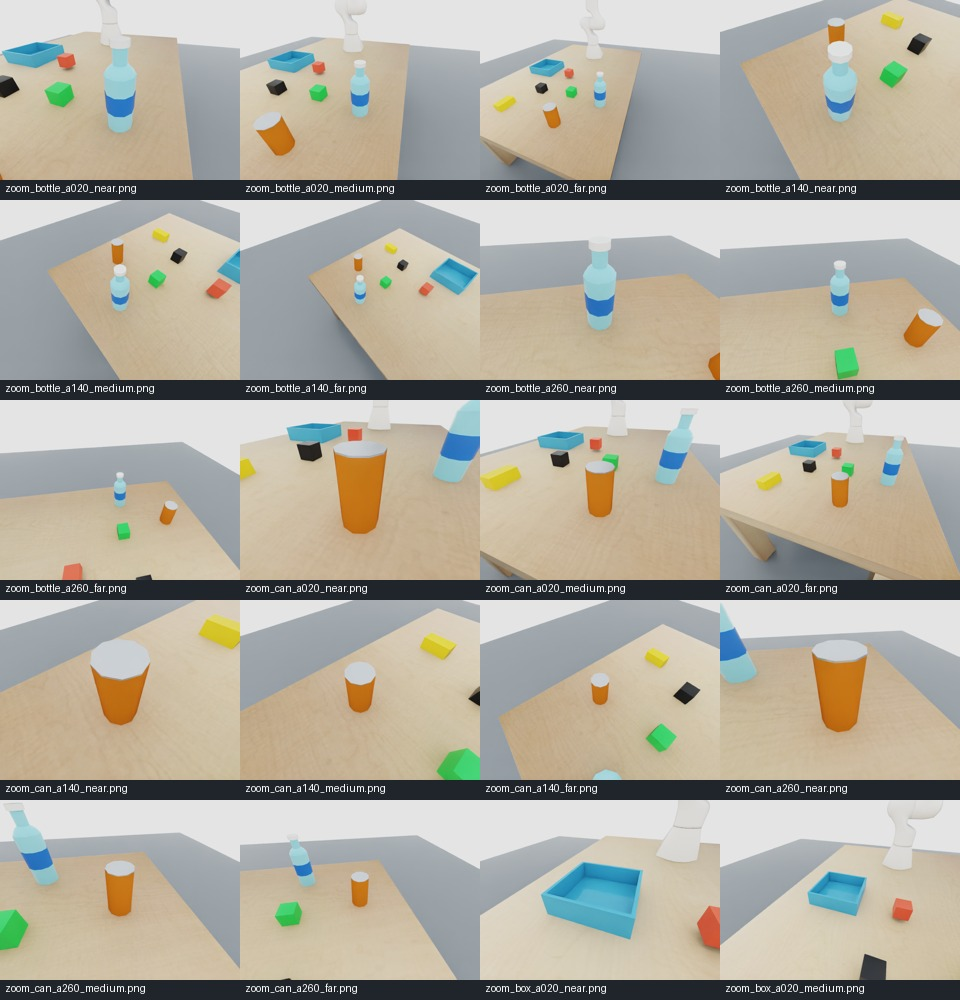
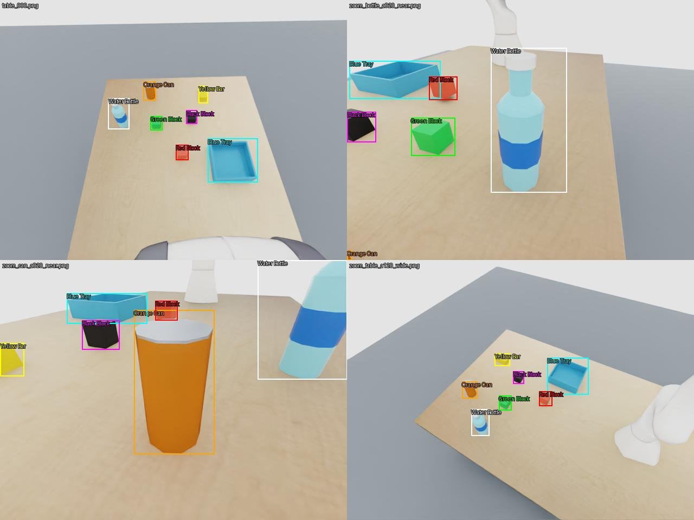
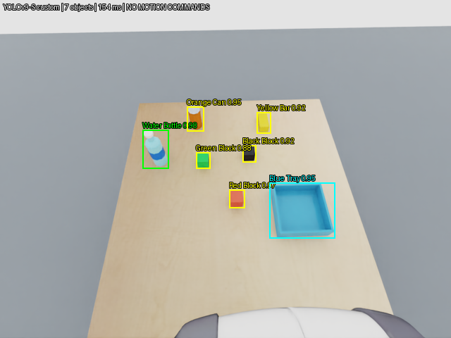

# From Isaac Sim images to camera-guided manipulation

[← Project overview](../README.md)

This guide follows the workflow used in this project: **scene → capture → CVAT → COCO → YOLO → ROS camera → guarded simulation**. It distinguishes stored evidence from instructions for a new run. All robot motion here is simulated.

## 1. Prepare the world

The cluttered tabletop contains a Panda, an open blue tray, red/black/green cubes, a yellow bar, an orange can, and a water bottle. See [scene construction](cluttered_tabletop.md). Downloaded assets and generated USD scenes are local artifacts, not included in the public Git repository.

Use a prepared Isaac Sim 6.2 host with the required assets restored. Keep three environments separate:

| Environment | Role |
|---|---|
| `env_isaacsim` | Physics, scene rendering, virtual camera, simulation controller |
| `env_yolov9_train` | Official YOLOv9-S GPU fine-tuning |
| `env_yolov9_cpu` | Official/custom YOLOv9 CPU inference and ROS image processing |

Do not install training dependencies into the working simulator environment. These commands do not call for changing drivers or system CUDA.

## 2. Capture synthetic training views

The [capture script](../isaac/scripts/collect_table_images.py) records a baseline wrist view and virtual orbit/close-up views. It does not execute physical robot trajectories. The original collection has 61 orbit/baseline images plus 75 detail views; only a selected subset was labeled for the reported run.

On a prepared host, choose **new empty destinations**:

```bash
./env_isaacsim/bin/python isaac/scripts/collect_table_images.py --mode orbit --output tableimage/new_orbit
./env_isaacsim/bin/python isaac/scripts/collect_table_images.py --mode detail --output tableimage/new_detail
```

The collector refuses nonempty output folders. Retain capture manifests, camera metadata, and image hashes. Review the contact sheets for clipped objects, robot occlusion, unusable views, and duplicates before annotation. Do not upload contact sheets themselves as training samples.



These are synthetic renders, not real-camera photographs. New capture runs produce new provenance and need their own review.

## 3. Label the images in CVAT

CVAT is an **independent installation**. This repository's Compose configuration is for CPU inference, not a CVAT server or backup. Open your own CVAT deployment and sign in directly; credentials do not belong in this repository.

1. Create a CVAT project/task for **object detection with bounding boxes**.
2. Define these exact labels: **Blue Tray, Red Block, Black Block, Green Block, Yellow Bar, Orange Can, Water Bottle**.
3. Upload the selected individual PNG images. Exclude metadata, montages, and known unusable views.
4. Open each annotation job and draw a consistent, tight box around each visible target object. Review the entire image so small or partially visible instances are not silently missed. Establish a consistent occlusion convention for the dataset.
5. Check every image for wrong class names, missing objects, duplicate boxes, and boxes extending outside the image. Review close-ups and distant objects separately.
6. Export **COCO 1.0 detection annotations** (include images or retain the original image set alongside them). The actual project training run used COCO JSON, not a direct YOLO export.
7. Preserve the original export. Arrange its files locally as the dataset preparer expects:

```text
data/datasets/
├── images/                      # selected original PNG images
└── labels/
    └── instances_default.json   # original COCO annotations
```

CVAT menu wording can vary by version. The important contract is COCO images/categories/annotations with axis-aligned bounding boxes and matching image files. CVAT's internal task database is not part of an annotation export.



*This preview was generated from the exported manual annotations, not captured from CVAT's UI.*

## 4. Audit, split, and convert without overwriting

The [preparation script](../scripts/prepare_yolov9_dataset.py) checks file/image identity, dimensions, duplicates, class IDs, bounding-box bounds, and unsupported annotations. It creates a new YOLO-format dataset and refuses to overwrite an existing destination.

```bash
./env_yolov9_train/bin/python tests/test_yolov9_dataset.py
./env_yolov9_train/bin/python scripts/prepare_yolov9_dataset.py
```

Skip preparation if the intended derived dataset already exists; inspect its audit rather than deleting it or overwriting it blindly.

For the recorded run:

- Input: **73 images / 423 boxes**.
- Excluded: `zoom_table_a180_wide.png` and `zoom_table_a180_wider.png` (known occlusion problems).
- Output: **58 train images / 331 boxes**, **13 validation images / 91 boxes**.
- Related views grouped into **60° azimuth sectors**, rather than a random image-level split.
- Output directory: `data/datasets/yolov9_tabletop_v1/`, including `audit.json` and `annotation_preview.jpg`.

COCO category IDs 1–7 map to YOLO IDs 0–6 in the class order above. **These are not the pretrained COCO model's class IDs.** Do not reuse the pretrained detector's class assumptions for the custom model.

## 5. Fine-tune the official model

Follow the [training environment and weight instructions](yolov9_training.md) first. Use the pinned official checkout and original **dual-head** YOLOv9-S pretrained weights, not the converted inference checkpoint.

```bash
./env_yolov9_train/bin/python scripts/train_official_yolov9.py
```

The launcher defaults to 100 epochs, batch 8, 640-pixel input, AdamW, seed 42, and color-aware augmentation. It records provenance and uses unique run names. Review [the launcher](../scripts/train_official_yolov9.py) for explicit configuration options before starting a new run.

Outputs include best/last checkpoints, training curves, prediction montages, a confusion matrix, metrics, and run metadata. A checkpoint score alone is not enough: inspect missed objects and false positives visually.

The recorded run achieved **mAP@50 0.966 / mAP@50:95 0.818** in final best-checkpoint revalidation. There is no independent test set, and this one-scene dataset cannot establish real-world robustness.

## 6. Connect the trained model to the wrist camera

The [custom model configuration](../configs/yolov9_tabletop.json) pins the checkpoint hash, upstream revision, and class mapping. A different training run needs its own reviewed configuration; do not silently substitute weights.

Start the frozen RGB-D camera, the CPU detector, and RViz in separate terminals as shown in the [README quick start](../README.md#getting-started). All three use **ROS domain 44**.

The [camera publisher](../isaac/scripts/wrist_camera_ros.py) creates a virtual hand-mounted sensor in an unsaved session layer:

- RGB: 640 × 480, `rgb8`.
- Depth: registered `32FC1` in metres along the camera optical Z axis.
- RGB/depth CameraInfo and matching TF.
- Synchronized wall-clock timestamps; RViz uses `use_sim_time=false`.
- Frozen physics and playback lock; no manipulation commands from the detector.

RViz displays raw RGB, depth, and YOLO boxes separately. An empty annotation panel can mean the detector is not running, even if raw camera frames are healthy. Enable the corresponding Image displays if they start unchecked.



## 7. Convert accepted detections into target geometry

For motion preparation, [the detector's capture mode](../scripts/wrist_yolo_ros.py) requires five fresh, stable observations with matching RGB, depth, camera calibration, and TF. A box alone is not a 3D target.

Optical-axis depth is back-projected using the camera intrinsics, then transformed into world coordinates. Bottle/tray refinement uses known shape, color, size, and orientation assumptions **after** YOLO recognition. The result is a model-specific tabletop estimator, not a general unknown-object pose estimator.

Ambiguity, stale frames, missing transforms, inconsistent depth, and visible tray obstructions are rejected. No simulator object pose is substituted to rescue a failed recognition result. See [the full geometry contract](trained_wrist_detection.md#rgb-d-geometry-and-rejection-rules).

## 8. Validate manipulation separately from perception

**Validation runs physics and can move the simulated robot.** It is not a syntax-only check. Do not start multiple controllers for the same scene.

The bottle workflow takes a fresh domain-44 snapshot, then starts a separate **domain-46** physics scene. IK and contact/slip/tracking guards remain active. Visible validation uses the real moving robot's wrist RGB camera, but that stream does **not** publish moving depth, CameraInfo, or TF.

The detector publishes diagnostics, not motor commands. Movement uses the pre-motion RGB-D targets; live video overlays are **not closed-loop visual servoing**.

The recorded successful bottle validation included supported tray placement, finger opening, retreat, and HOME return. The green-cube-beside-bottle experiment remains blocked. Never treat a successful perception score or copied validation report as permission to move in a new scene.

Use the [motion guide and approval rules](trained_wrist_detection.md#text-command-and-execution-gate) when deliberately starting a new trial. Failed runs pause without automatic retry/release. Revalidate after code, model, scene, or machine changes.

## 9. Publish a reproducible, lightweight project

This Git repository publishes source, configuration, explanations, and selected images under [the gallery](images/README.md). It deliberately excludes full datasets, CVAT exports, model checkpoints, virtual environments, generated scenes/assets, and runtime logs.

For private transfer, use [the portable bundle workflow](portable_setup.md); export CVAT annotations first, because labels remaining only in CVAT's database are not copied automatically. Review redistribution licenses before publishing third-party assets or weights.

### Reproduction checklist

- [ ] Compatible Isaac/ROS installation and separate Python environments.
- [ ] Required local scene assets and original annotation export restored.
- [ ] Image/annotation audit and class mapping reviewed.
- [ ] Split integrity and independent evaluation limitations understood.
- [ ] Official checkout and checkpoint provenance verified.
- [ ] Fresh synchronized RGB-D/TF delivery verified.
- [ ] New manipulation validation passed before any separate execution.