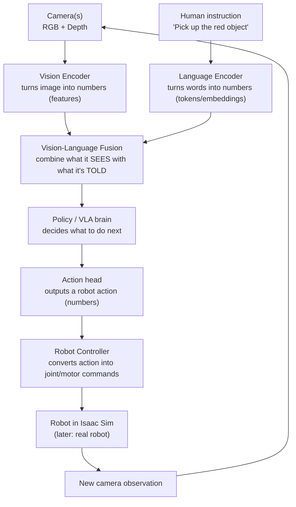

# Phase 0 — Understand My Computer

> Goal of this phase: **verify** what is already installed. Install nothing yet.
> First we understand the big picture, then we check the environment in small batches.

---

## Part 1 — The Complete VLA Robot Architecture (high-level)

A VLA robot **turns pixels + words into motion**, then watches the result and adjusts.



**Key idea:** every arrow is just data (numbers/tensors) flowing between boxes. Nothing is magic — each box is a transformation you will eventually understand and build.

### What each box does (plain intuition)

| Box | Plain-language job | Human analogy |
|-----|-------------------|---------------|
| Vision Encoder | Compress an image into a compact list of numbers describing "what's here" | Eyes + visual cortex |
| Language Encoder | Turn the sentence into numbers a computer can reason with | Ears + language comprehension |
| Fusion | Line up "red thing at top-left" with the word "red" | Brain connecting sight to speech |
| Policy (VLA) | Decide the next move given scene + goal | Decision-making |
| Action head | Produce concrete numbers: move hand +2 cm right, close gripper | Motor planning |
| Controller | Translate intent into actual joint motions | Spinal cord / muscles |
| Feedback loop | Look again, check progress, correct | Hand-eye coordination |

### Two crucial teaching points

1. **VLM vs VLA.** A **VLM** (Vision-Language Model) only *describes* — "there is a red cube on the table." A **VLA** (Vision-Language-Action model) must *act* — output numbers that move a robot. That extra "Action" is the hard, robotics-specific part. (Deep dive in Phase 9.)

2. **Classical first, then learned.** We build the *classical* pipeline first (Phase 7) using hand-written computer vision + inverse kinematics, **before** replacing pieces with neural networks. You must understand what the VLA is *replacing* to understand what it does.

---

## Part 2 — Environment Checklist

We only **verify** today — **install nothing.**

### Hardware
- [ ] **NVIDIA GPU** (RTX class; Isaac Sim needs RTX ray tracing). Ideally >= 8 GB VRAM, better >= 12 GB for training.
- [ ] Decent CPU + >= 32 GB RAM recommended (16 GB workable early).
- [ ] ~50+ GB free disk (Isaac Sim + datasets grow fast).

### Core software
- [ ] **Ubuntu 24.04** (target for ROS 2 Jazzy).
- [ ] **NVIDIA driver** (recent; supports your GPU + CUDA).
- [ ] **CUDA** (for PyTorch training later).
- [ ] **Python 3.12** (ships with Ubuntu 24.04 / ROS 2 Jazzy).
- [ ] **ROS 2 Jazzy** (believed installed — we verify).
- [ ] **Git**.

### Simulation + AI (later phases — just check presence today)
- [ ] **NVIDIA Isaac Sim** (4.x).
- [ ] **Isaac Lab** (optional; RL/learning workflows).
- [ ] **Gazebo** (optional alternative simulator).
- [ ] **GitHub CLI** (`gh`) — optional convenience.
- [ ] **VS Code + GitHub Copilot** (already available).

---

## Part 3 — Verification Commands

Run in a normal terminal (`Ctrl+Alt+T`). Paste back the full output of each.

### Batch 1 — Foundation

#### 1. Ubuntu version
```bash
lsb_release -a
```
- **Does:** prints Linux distribution and version.
- **Expect:** `Description: Ubuntu 24.04.x LTS`.
- **If different:** 22.04 is fine to know; Jazzy prefers 24.04. Change nothing yet.

#### 2. NVIDIA GPU + driver + driver-reported CUDA
```bash
nvidia-smi
```
- **Does:** shows GPU model, driver version, and max CUDA the driver supports.
- **Expect:** a table with `NVIDIA GeForce RTX ...`, `Driver Version: 5xx.xx`, and `CUDA Version: 12.x` (top-right).
- **If "command not found"/error:** driver not installed/loaded. Report the exact message; we diagnose, not blindly reinstall.

#### 3. CUDA toolkit (compiler) — separate from the driver
```bash
nvcc --version
```
- **Does:** checks if the CUDA *toolkit* (dev tools) is installed (different from the driver's runtime).
- **Expect:** `release 12.x`.
- **If "command not found":** OK and common — PyTorch ships its own CUDA runtime. Just report it.

#### 4. Python
```bash
python3 --version
```
- **Does:** shows the system Python version.
- **Expect:** `Python 3.12.x` on Ubuntu 24.04.
- **If different:** note it; Jazzy is built against 3.12.

### Batch 2 — (given after Batch 1 results)
ROS 2 Jazzy, Git, GitHub CLI, Isaac Sim, Isaac Lab, Gazebo.

---

## Next step
Run **Batch 1** (4 commands) and paste the full output of each.
Then I provide Batch 2 and tell you exactly what — if anything — is missing.
