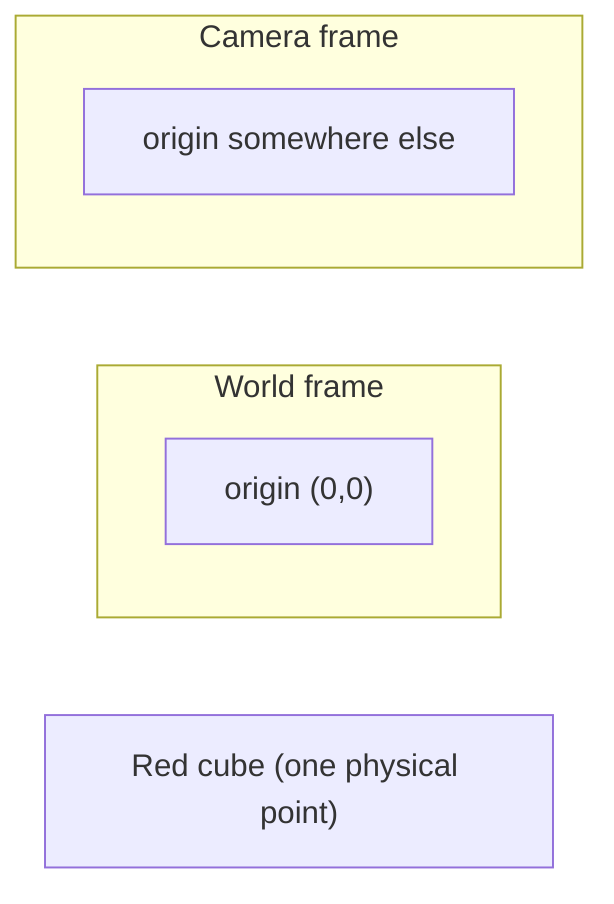

# Phase 1 — Transforms (Part A: 2D frames, translation, rotation)

> Goal of this phase: understand **coordinate frames** and how to move points
> between them. This is *the* language of robotics — every joint, camera, and
> object has a frame, and a robot's whole job is relating them.
> Intuition first, math second, then you implement and verify.

---

## 1. Why transforms? (the motivating problem)

Your robot camera sees a red cube "40 cm ahead and 10 cm to the left **of the camera**."
But the robot arm doesn't move relative to the camera — it moves relative to its
**base**. So you must answer:

> "Where is the cube **relative to the robot base**?"

Converting a position from one frame ("as seen by the camera") to another frame
("as the base understands it") is a **transform**. That's the entire idea. Master
this and robotics stops being mysterious.

---

## 2. What is a coordinate frame?

A **frame** is just an origin (a chosen zero point) plus axes (directions).
The *same* physical point has *different numbers* in different frames.



The cube is one real thing, but:
- In the **camera** frame it might be `(0.40, 0.10)`.
- In the **world** frame it might be `(1.2, 0.5)`.

Neither is "wrong" — they're the same point described from different viewpoints.

**A point is a vector of numbers; a frame is the context that gives those numbers meaning.**

---

## 3. Points as vectors

In 2D, a point is just two numbers:

$$ \mathbf{p} = \begin{bmatrix} x \\ y \end{bmatrix} $$

Example: `p = [0.4, 0.1]` means x=0.4 m, y=0.1 m from that frame's origin.

---

## 4. Translation (shifting the origin)

If frame B's origin sits at position $\mathbf{t} = [t_x, t_y]$ **within frame A**,
then a point known in B is expressed in A by **adding** the offset:

$$ \mathbf{p}_A = \mathbf{p}_B + \mathbf{t} $$

**Intuition:** "start where B's origin is, then walk out to the point."

Example: camera origin is at `[1.0, 0.0]` in the world. Cube is `[0.4, 0.1]` in the
camera frame (pointing the same way). In the world:
`[0.4, 0.1] + [1.0, 0.0] = [1.4, 0.1]`.

---

## 5. Rotation (turning the axes)

If frame B is **rotated** by angle $\theta$ relative to frame A, a point in B is
expressed in A by multiplying with the **rotation matrix**:

$$ R(\theta) = \begin{bmatrix} \cos\theta & -\sin\theta \\ \sin\theta & \cos\theta \end{bmatrix}, \qquad \mathbf{p}_A = R(\theta)\,\mathbf{p}_B $$

**Intuition:** rotating a point by $\theta$ swings it counter-clockwise around the
origin. The matrix is just "the recipe" that mixes x and y to do that swing.

**Sanity checks (do these in your head):**
- $\theta = 0$: $R = \begin{bmatrix}1&0\\0&1\end{bmatrix}$ (identity) → point unchanged. ✅
- Rotate `[1, 0]` by 90°: expect `[0, 1]` (x-axis swings up to the y-axis).

Worked math for the 90° case ($\cos 90°=0,\ \sin 90°=1$):
$$ \begin{bmatrix}0&-1\\1&0\end{bmatrix}\begin{bmatrix}1\\0\end{bmatrix} = \begin{bmatrix}0\\1\end{bmatrix} \ ✅ $$

---

## 6. Your task (implement + verify)

Open [../src/utils/transforms_2d.py](../src/utils/transforms_2d.py). It has three
functions with `TODO`s:

1. `translate(point, offset)` — add the offset.
2. `rotation_matrix(theta)` — build $R(\theta)$ (angle in **radians**).
3. `rotate(point, theta)` — apply the rotation matrix to the point.

Then run the file. It has a built-in self-check that prints **PASS/FAIL** for each.

```bash
cd ~/Music/projects_abbas/ROBOT_VLA
python3 src/utils/transforms_2d.py
```

**Expected output when correct:**
```
[test] translate     -> PASS
[test] rotation_matrix -> PASS
[test] rotate 90deg  -> PASS
[test] rotate 0deg   -> PASS
All tests passed. 🎉
```

**If you get FAIL:** read which line failed, re-check the formula above, fix, rerun.
Report your output and I'll confirm before we go to Part B (combining rotation +
translation into a single **homogeneous transform**, then 3D).

---

## What's next (do NOT start yet)
- Part B: homogeneous transforms (rotation + translation in one matrix).
- Part C: 3D frames, and the TF tree ROS 2 uses.
